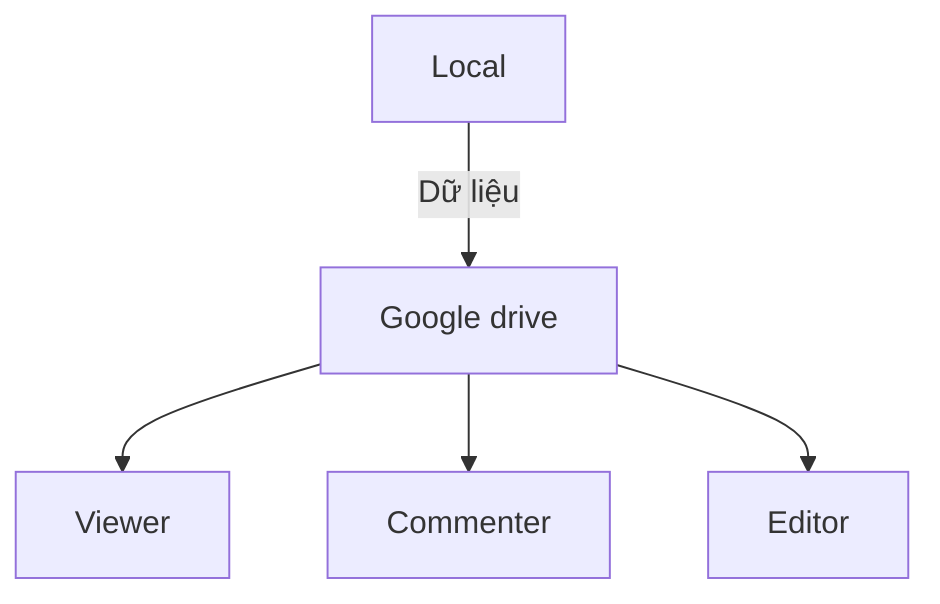

# Yêu cầu đầu ra
## Phần 1: Thiết kế kiến trúc
### 1/

### 2/ Cấu trúc thư mục Google Drive
CampusPay/                          ← Shared Drive (nguồn dữ liệu chính)

- 01_Dieu_Hanh/                   ← Trưởng nhóm; các ban chỉ xem phần báo cáo
    + Noi_Quy_Onboarding/         ← Team Charter, checklist onboarding, hướng dẫn cài công cụ
    + Bao_Cao_Tien_Do/            ← Báo cáo tuần bản gốc nội bộ, kế hoạch sprint
    + Audit_Ban_Giao/             ← Biên bản audit hàng tháng; gói giao nộp cuối dự án

- 02_Ky_Thuat/                    ← Ban Kỹ thuật 
    + Code_Backup/                ← Git bundle hàng tuần, file release (code chính ở kho Git)
    + SRS/                        ← Tài liệu đặc tả yêu cầu phần mềm, tài liệu kỹ thuật

- 03_Thiet_Ke/                    ← Ban Thiết kế
    + UI_UX/                      ← Wireframe, mockup xuất từ Figma, logo, màu sắc
    + Slide_Pitch/                ← Bản nháp và bản cuối slide pitch

- 04_Kinh_Doanh/                  ← Ban Kinh doanh 
    + Tai_Lieu_KD/                ← Kế hoạch kinh doanh, nghiên cứu thị trường
    + Du_Lieu_Khach_Hang/           ← HẠN CHẾ: chỉ Kinh doanh và Trưởng nhóm 

- 05_Nha_Tai_Tro/                 ← Trưởng nhóm; Nhà tài trợ (V, PIN, có hạn)
    + Bao_Cao_Tuan/               ← CHỈ chứa PDF báo cáo đã duyệt, đã lược dữ liệu nhạy cảm
## Phần 2: Sản phẩm hoàn chỉnh
### 3/
**Chú thích:** M = Manager, E = Editor (xem, sửa), C = Commenter (xem, bình luận), V = Viewer (chỉ xem, tắt tải/in/sao chép), – = không thấy thư mục.

| Vai trò (nhóm) | Code | Tài liệu SRS | Tài liệu KD | Báo cáo tiến độ | Dữ liệu khách hàng | Slide Pitch |
|---|---|---|---|---|---|---|
| **Trưởng nhóm**  | V | V | E | **M** | V (chỉ để audit, có ghi log) | **M** |
| **Kỹ thuật**  | **E** | **E** | – | V | – (dùng dữ liệu giả) | C |
| **Thiết kế**  | – | C | – | V | – | **E** |
| **Kinh doanh**  | – | C | **E** | V | **E** | E |
| **Nhà tài trợ** | – | – | – | V (chỉ bản PDF, PIN, có hạn) | – | – |
### 4/ 
#### a/ Cấu trúc Channel và mục đích từng kênh
| Kênh | Mục đích | Ai được đăng |
|---|---|---|
| `#00-thong-bao` (ghim) | Thông báo chính thức: quyết định, deadline, thay đổi quy trình. Là nơi duy nhất có giá trị "đã thông báo" | Chỉ trưởng nhóm và Admin phụ; mọi người phản hồi bằng emoji |
| `#01-chung` | Trao đổi chung, hỏi đáp quy trình, thảo luận ngoài lề | Tất cả |
| `#02-ky-thuat` | Code, bug, review (link tới `02_Ky_Thuat`) | Tất cả |
| `#03-thiet-ke` | UI/UX, slide pitch, feedback thiết kế (link tới `03_Thiet_Ke`) | Tất cả |
| `#04-kinh-doanh` | Thị trường, khách hàng, kế hoạch kinh doanh (không đăng dữ liệu khách hàng thật) | Tất cả |
| `#05-bao-cao-tien-do` | Cập nhật tiến độ hàng tuần theo mẫu | Tất cả |
| `#06-khan-cap`  | Chỉ dùng cho sự cố khẩn cấp (xem mục c) | Tất cả |
| Nhóm riêng "Trưởng nhóm-Quan-Tri" | Tài chính, nhân sự, vấn đề nhạy cảm | Trưởng nhóm và Admin phụ |
| Nhóm ngoài "CampusPay x Tai-Tro" | Liên lạc với nhà tài trợ | Chỉ trưởng nhóm |
#### b/ 5 quy tắc giao tiếp bắt buộc

1. **Đúng kênh, đúng mục đích.** Việc công (giao việc, quyết định, hỏi đáp) làm trong kênh, không làm qua tin nhắn riêng hay nhóm chat cá nhân. Tin nhắn riêng không có giá trị là "đã giao việc" hay "đã quyết định".
2. **Thông báo quan trọng chỉ đăng ở `#00-thong-bao`**, theo mẫu `[LOẠI] Nội dung | Hạn | Người phụ trách`. Mọi thành viên bấm  trong vòng 24 giờ. Ai chưa xác nhận sẽ được TN nhắc trực tiếp (xử lý vấn đề 3).
3. **Chia sẻ bằng link Drive, không gửi file đính kèm.** Tuyệt đối không gửi dữ liệu khách hàng, mật khẩu hay khóa API qua chat. Trước khi gửi link phải kiểm tra link đúng quyền.
4. **Thời gian phản hồi:** trong 08:00 đến 22:00, phản hồi @mention trong vòng 4 giờ. Giờ yên tĩnh 22:00 đến 07:00 không bắt buộc phản hồi, trừ `#06-khan-cap`. Nếu vắng mặt, báo trước ở `#01-chung`.
5. **Mọi việc phải có Task, mọi quyết định phải có biên bản.** Giao việc bằng Lark Task có người phụ trách và hạn chót. Quyết định ghi vào Lark Docs và đăng link ở `#00-thong-bao`. Trả lời theo thread để không trôi tin.

#### c/ Quy trình xử lý tin nhắn khẩn cấp

**Định nghĩa:**
- **P1 (nghiêm trọng):** lộ dữ liệu khách hàng, mất file hoặc code không khôi phục được, hệ thống sập, tài khoản bị xâm nhập.
- **P2 (gấp):** việc chặn tiến độ cả nhóm, hạn nộp còn dưới 24 giờ.
- Việc thông thường không được dùng kênh này.

| Bước | Hành động | Thời hạn |
|---|---|---|
| 1 | Người phát hiện đăng vào `#06-khan-cap`: `[P1/P2] Chuyện gì | Từ khi nào | Ảnh hưởng gì`, @tất cả, kèm **Buzz** (tin nhắn khẩn của Lark) cho TN | Ngay lập tức |
| 2 | TN hoặc Admin phụ xác nhận "Đã nhận" và làm **điều phối sự cố** | ≤ 15 phút |
| 3 | Nếu không ai xác nhận: gọi điện lần lượt TN, KT lead, thành viên còn lại | 15 đến 30 phút |
| 4 | Điều phối ra lệnh xử lý. Nếu liên quan dữ liệu: **thu hồi quyền ngay**, đổi mật khẩu, tắt link chia sẻ | Ngay sau khi xác nhận |
| 5 | Đăng cập nhật ở `#06` và tóm tắt ở `#00-thong-bao` | Cùng ngày |
| 6 | Viết báo cáo sự cố ngắn (nguyên nhân, khắc phục, phòng ngừa), lưu ở `01_Dieu_Hanh/Audit_Ban_Giao/` | ≤ 48 giờ |

#### d/ Audit định kỳ hàng tháng (đáp ứng Ràng buộc 4)

Thực hiện vào ngày làm việc đầu tiên mỗi tháng, Admin phụ thực hiện, TN duyệt.

| # | Kiểm tra | Cách làm | Ghi lại |
|---|---|---|---|
| 1 | Ai có quyền gì | Xuất danh sách thành viên Shared Drive và từng Google Group, đối chiếu với bảng phân quyền mục 3 | Bảng đúng/lệch, người có quyền thừa |
| 2 | Link chia sẻ bất thường | Rà soát file có chia sẻ ngoài tổ chức hoặc link công khai | Danh sách link đã thu hồi |
| 3 | Truy cập dữ liệu khách hàng | Xem nhật ký truy cập `04_Kinh_Doanh/Du_Lieu_Khach_Hang/` | Truy cập bất thường (nếu có) |
| 4 | Quyền nhà tài trợ | Kiểm tra hạn truy cập `05_Nha_Tai_Tro`, gia hạn hoặc thu hồi | Ngày hết hạn mới |
| 5 | Channel kém hoạt động | Xem số tin nhắn từng kênh trong 30 ngày; kênh dưới ngưỡng (ví dụ < 5 tin/tháng) thì nhắc, gộp hoặc lưu trữ | Danh sách kênh và quyết định |
| 6 | Thông báo chưa xác nhận | Kiểm tra tỷ lệ ✅ ở `#00-thong-bao` | Danh sách người chưa xác nhận |
| 7 | Tài khoản thành viên | Phát hiện tài khoản không còn tham gia hoặc chưa bật 2FA | Danh sách xử lý |

Kết quả lưu thành `Audit_YYYY-MM` trong `01_Dieu_Hanh/Audit_Ban_Giao/`.
### 5/
| # | Thời gian | Hành động | Công cụ | Kết quả kiểm tra |
|---|---|---|---|---|
| 1 | 0–5' | Chấp nhận lời mời, đăng nhập Lark, đổi tên hiển thị theo mẫu `[Ban] Họ tên` | Lark | Thấy `#00-thong-bao` và `#01-chung`; tên đúng mẫu |
| 2 | 5–10' | Bật xác thực 2 bước cho Google và Lark | Google Account, Lark | Trạng thái 2FA "Bật"; đăng " 2FA xong" ở `#01-chung` |
| 3 | 10–15' | Mở Shared Drive "CampusPay", vào thư mục ban mình và thử mở 1 thư mục không thuộc quyền | Google Drive | Vào được thư mục ban mình; **không thấy hoặc bị từ chối** thư mục cấm. Nếu sai, báo ngay ở `#01-chung` |
| 4 | 15–25' | Đọc Team Charter (`01_Dieu_Hanh/Noi_Quy_Onboarding/`), làm quiz 5 câu | Google Docs, Lark Form | Đạt ≥ 4/5; tick "Đã đọc và cam kết tuân thủ" |
| 5 | 25–35' | Cài công cụ theo ban: Drive for Desktop (chỉ đồng bộ thư mục ban mình); KT cài Git và IDE; TK vào workspace Figma; KD mở Lark Base | Hướng dẫn trong `Noi_Quy_Onboarding` | Tạo `hello_<tên>.txt` trong thư mục ban, file xuất hiện trên Drive web |
| 6 | 35–40' | Bật thông báo cho `#00-thong-bao` và `#06-khan-cap`, ghim các kênh quan trọng | Lark | Nhận được tin nhắn thử từ bot Onboarding |
| 7 | 40–45' | KT: clone repo, push 1 commit vào nhánh `wip/<tên>`. TK và KD: mở file mẫu của ban và để lại 1 bình luận | Git / Figma / Drive | Commit hoặc bình luận hiển thị trên cloud |
| 8 | 45–50' | Đăng bài tự giới thiệu theo mẫu ở `#01-chung`; tick hoàn tất trên Lark Approval | Lark | Bot ghi nhận hoàn tất; Admin có log để audit |

### 6/ 
#### Edge Case 1: Thành viên KT nghỉ bệnh 3 ngày, code nằm trên máy ở nhà

**Nguyên tắc:** không ai truy cập máy cá nhân hay dùng tài khoản của người đó.

- **Phòng ngừa (xử lý gốc rễ):**
  - Cuối mỗi ngày `git push` lên nhánh `wip/<tên>` (tức là Work in process: đây là tên tự quy ước), kể cả code chưa hoàn thiện.
  - Bundle code hàng tuần lưu vào `02_Ky_Thuat/Code_Backup/`.
  - Mỗi module có 1 người chính và 1 người phụ (reviewer), nên luôn có ít nhất 2 người hiểu code.
- **Khi sự cố xảy ra:**
  1. Đăng yêu cầu ở `#02-ky-thuat`, @người nghỉ bệnh. Nếu còn sức, họ chỉ cần push từ nhà (vài phút).
  2. Nếu không liên lạc được: lấy nhánh `wip/` gần nhất trên Git hoặc bản bundle gần nhất. Mất tối đa công việc của 1 ngày.
  3. Người khác tiếp tục trên nhánh mới, ghi chú vào Lark Task để khi người bệnh quay lại thì merge.
- **Không vi phạm bảo mật:** không chia sẻ mật khẩu máy hay tài khoản, không cấp thêm quyền.

#### Edge Case 2: Nhà tài trợ chỉ có email Outlook, cần xem báo cáo hàng tuần

1. Trưởng nhóm xuất báo cáo đã duyệt thành **PDF**, lược bỏ dữ liệu nhạy cảm (không chứa dữ liệu khách hàng), lưu vào `05_Nha_Tai_Tro/Bao_Cao_Tuan/`.
2. Chia sẻ **chỉ thư mục này** (không chia sẻ thư mục cha) cho đúng địa chỉ Outlook của nhà tài trợ bằng tính năng **chia sẻ cho người không có tài khoản Google** (xác minh bằng mã PIN gửi về email), quyền **Viewer**.
3. Đặt **ngày hết hạn** truy cập (ví dụ 3 tháng) và tắt tải xuống, in, sao chép.
4. Không dùng link "Bất kỳ ai có đường liên kết".
5. Dự phòng nếu tính năng này không khả dụng với tài khoản của nhóm: TN gửi PDF có watermark ghi tên người nhận qua email, không gửi file gốc.
6. Việc chia sẻ được kiểm tra trong audit hàng tháng (mục d, dòng 2 và 4).

#### Edge Case 3: Kết thúc dự án, giao nộp cho trường mà không mất lịch sử phiên bản

| Bước | Hành động |
|---|---|
| 1 | **Đóng băng:** thông báo ở `#00-thong-bao`, ngừng chỉnh sửa; thu hồi quyền Editor, chỉ giữ TN và Admin phụ |
| 2 | **Code:** xuất toàn bộ kho Git kèm lịch sử bằng `git clone --mirror` hoặc `git bundle create`, vì lịch sử commit chính là lịch sử phiên bản của code |
| 3 | **Tài liệu:** tải về dạng DOCX/PDF/XLSX; trước đó đặt tên các bản mốc quan trọng trong Version History (ví dụ "SRS v1.0 - bản nộp") |
| 4 | **Lịch sử phiên bản tài liệu:** lập `CHANGELOG.md` ghi các bản mốc (ngày, người sửa, nội dung). Nếu trường dùng Google Workspace, **chuyển quyền sở hữu Shared Drive hoặc thư mục** sang tài khoản của trường để giữ nguyên Version History |
| 5 | **Dữ liệu khách hàng:** không đưa vào gói giao nộp, hoặc chỉ đưa bản đã ẩn danh nếu trường yêu cầu và được đồng ý |
| 6 | **Toàn vẹn:** tạo mã băm SHA-256 cho từng gói, ghi vào `MANIFEST.txt` |
| 7 | **Bàn giao:** lưu gói vào `01_Dieu_Hanh/Audit_Ban_Giao/Ban_Giao_Cuoi_Du_An/`, lập biên bản bàn giao có chữ ký 2 bên |
| 8 | **Đóng hệ thống:** sau khi trường xác nhận nhận đủ, thu hồi toàn bộ quyền (kể cả nhà tài trợ), giữ lưu trữ 30 ngày rồi xóa theo quyết định của nhóm |